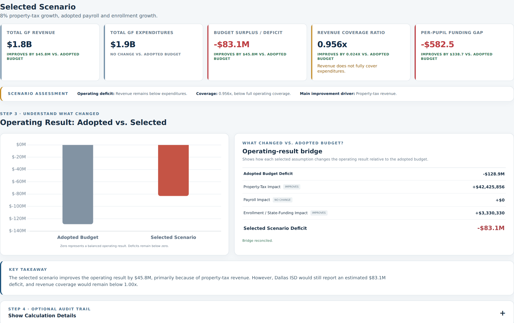
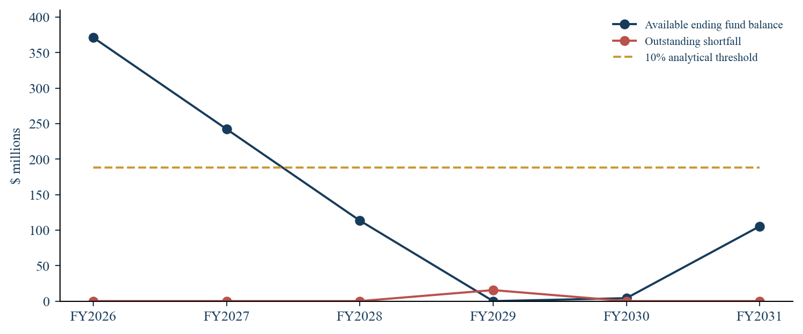
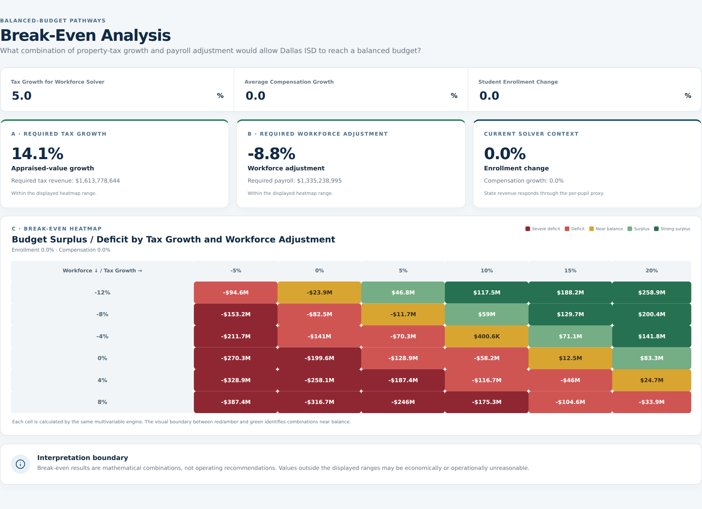

# Dallas ISD Financial Risk & Scenario Analysis Dashboard

**Stress the budget. Explain the impact. Explore the fiscal outlook.**

An independent Public Finance research project that connects Dallas ISD's FY2026 adopted General Fund budget with an interactive financial scenario application. Load a structured Excel workbook, test property-tax, payroll and enrollment assumptions, and evaluate both the operating result and the fiscal path to recovery.

Built by **Roberto Almeida**, MS in Quantitative Finance, University of Texas at Arlington.

This is a financial research and scenario-analysis framework. It does not assign credit ratings, produce an official forecast or make investment recommendations.



## Explore the project

- [Full Financial Research & Technical Methodology Report](docs/reports/Dallas-ISD-Financial-Research-Report-Final.pdf)
- [Three-page Project Showcase](docs/reports/Dallas-ISD-LinkedIn-Project-Showcase.pdf)
- [Financial and Technical Methodology](docs/METHODOLOGY.md)
- [Data sources and provenance](docs/DATA_SOURCES.md)
- [Public source workbook](src/assets/Dallas-ISD-Budget-Public.xlsx)
- [Release and verification notes](docs/RELEASE_NOTES.md)

**Application access:** [Open the live demo](https://ralmeidaa22.github.io/dallas-isd-financial-risk-dashboard/), download `index.html` from the [v1.0.1 release](https://github.com/ralmeidaa22/dallas-isd-financial-risk-dashboard/releases/tag/v1.0.1) for standalone use, or build locally using the instructions below. GitHub's file preview does not execute the application.

The [public repository](https://github.com/ralmeidaa22/dallas-isd-financial-risk-dashboard) and demo are published. GitHub Pages downloads the bundled application initially; workbook parsing and scenario calculations then run in browser memory. The hosted demo was verified in Chrome with no HTTP(S) requests during sample loading, scenario operations or public workbook upload, and no console errors. The PDFs in v1.0.1 include verified repository, demo and original v1.0.0 release links; the original release remains intact.

## What you can do

| View | Analyst question | Capability |
| --- | --- | --- |
| Financial Overview | What does the adopted budget look like? | Revenue and expenditure composition, coverage, operating result and per-pupil metrics. |
| Scenario Analysis | How do changing drivers affect the budget? | Combine tax growth, workforce, compensation and enrollment; explain the change through a reconciled operating-result bridge. |
| Multi-Year Outlook | When is balance reached, and do reserves last? | Apply annual assumptions over 3, 5 or 7 future years; detect first balance and sustained recovery; reconcile available reserves and outstanding funding shortfall. |
| Break-Even Analysis | What combinations reach balance? | Algebraic tax/workforce solvers and a surplus/deficit sensitivity matrix. |
| Risk Drivers | Where are the financial concentrations? | Rule-based observations from workbook data and the selected scenario. |

## Selected findings

| Result | Interpretation |
| --- | --- |
| FY2026 revenue **$1,754.7M**, expenditures **$1,883.6M**, deficit **$128.9M** | Adopted budget starting position; revenue coverage is **0.932x**. |
| Property taxes are **96.4% of local revenue**; payroll is **77.7% of General Fund expenditures** | Material revenue and cost sensitivities. |
| 8% tax growth and 2% enrollment growth, with payroll unchanged, leave an **$83.1M deficit** | The illustrative upside improves the operating result by **$45.8M** but does not close the modeled gap. |
| Illustrative recovery path reaches first and sustained balance in **FY2030** | With an illustrative $500M starting reserve, depletion occurs before recovery. FY2030's $19.6M surplus first repays $15.5M of shortfall, leaving $4.1M of available balance. |

The recovery example uses 0% tax growth in FY2027–FY2029, 10% in FY2030 and 5% in FY2031, with workforce, compensation and enrollment changes at 0%. The $500M reserve is **not an official Dallas ISD balance**. Details and source references are in the full report.



## Data-to-analysis workflow

1. Research public budget documents and identify the relevant periods, funds and financial definitions.
2. Extract, clean and reconcile the figures into the structured Excel source model.
3. Load the workbook locally; the application checks seven required sheets and nine core FY2026 metrics.
4. Review the baseline, build a scenario and inspect its operating-result attribution.
5. Enter an annual path to evaluate operating recovery and reserve capacity.

The workbook contains source data, notes and reference calculations. The dashboard independently recalculates its financial outputs from mapped inputs; **it does not execute Excel formulas**. The historical preparation included manual and Python-assisted work; the original PDF extraction script is not included. `inspect_workbook.py` inspects OOXML and is not a PDF-to-Excel converter.

### Using another district

The preparation workflow can be reused: PDF → structured Excel → dashboard. A workbook must retain compatible sheets, labels, year headers and metric definitions, rather than merely matching sheet names. The current tax calibration, state-funding proxy and fund definitions are specific to the Dallas ISD case and require review before interpreting another issuer's results. This release does not claim cross-district validation.

Required sheets: `Budget Summary`, `GF Revenue`, `GF Expenditures`, `Other Funds`, `Enrollment`, `Scenario Analysis`, `Financial Ratios`. See [workbook inspection notes](docs/WORKBOOK_ANALYSIS.md) and [mapping methodology](docs/METHODOLOGY.md).

## Core model considerations

- Single-year tax scenarios use an inferred base: adopted tax revenue ÷ 1.05. The 5% calibration is linked to the official planning assumption for taxable appraised-value growth; it is not the historical tax-revenue growth rate.
- Payroll applies workforce and compensation changes multiplicatively.
- State revenue uses a fixed starting revenue-per-pupil proxy; it does not reproduce the Texas funding formula.
- Other local revenue, federal revenue and non-payroll expenditures remain fixed.
- Future-year tax revenue, enrollment and payroll compound from the prior year.
- First balance requires a non-negative annual operating result. Sustained recovery requires two consecutive non-negative results with coverage at least 1.00x.
- Surpluses repay outstanding funding shortfall before rebuilding available fund balance. Neither position is presented as a negative reserve.
- Fund balance is not necessarily cash liquidity. Modeled funding shortfall is not automatically a legal liability or borrowing.

External forecasts or model outputs can be translated into documented annual assumptions. The app does not execute ARIMA, GARCH, Monte Carlo or VaR, and does not independently validate user-entered paths.

## Run locally

Prerequisite: **Node.js 22 or later** and npm. Dependency installation requires internet access, including the official SheetJS CDN. Workbook processing and the built application run locally.

```bash
npm ci
npm run dev
```

Open the URL printed by Vite, normally `http://127.0.0.1:5173`, and choose **Load Sample Workbook** or upload a compatible `.xlsx` file.

```bash
npm test
npm run build
npm run preview
```

`npm run build` produces a single bundled `dist/index.html`, including dependencies and the public sample workbook. It can be opened through `file://` without a server. Workbooks are parsed in browser memory; no workbook data is uploaded.

### Browser checks

Run the build and keep `npm run preview` running in a separate terminal, then run:

```bash
npm run test:browser
```

The script defaults to Chrome's standard macOS installation and `http://127.0.0.1:4173`. On other systems, set the path to an installed Chrome or Chromium binary:

```bash
CHROME_EXECUTABLE_PATH=/absolute/path/to/chrome npm run test:browser
```

For the standalone check:

```bash
npm run test:browser -- file:///absolute/path/to/dist/index.html
```

Screenshots generated by tests go to ignored `test-results/`. See release notes for the distinction between prior verification and checks rerun for this package.

## Architecture

| File / component | Responsibility |
| --- | --- |
| `src/assets/Dallas-ISD-Budget-Public.xlsx` | Sanitized financial source workbook. |
| `src/lib/workbook.js` | Local SheetJS parsing into sheet arrays. |
| `src/lib/mapping.js` | Normalized label and nearest-header metric extraction. |
| `src/lib/validation.js` | Required inputs and financial reconciliations. |
| `src/lib/calculations.js` | Baseline, scenario, attribution and break-even calculations. |
| `src/lib/runway.js` | Multi-year outlook, recovery and fund-balance reconciliation. |
| `src/main.js`, `src/styles.css` | Vanilla JavaScript interface, state, charts and responsive styling. |
| `tests/` | Unit and browser workflow verification. |

The application uses **JavaScript, HTML/CSS, SheetJS and Chart.js**, with Vite and a single-file build plugin. Vitest supports unit tests; Playwright Core supports browser checks. There is no React framework, backend, database or authentication layer. Resolved versions are pinned in `package-lock.json`.



## Scope and limitations

This analysis covers budget sensitivity and financial flexibility. A complete municipal credit assessment also requires audited historical results, reserve restrictions, debt and pension obligations, liquidity, tax-base characteristics, demographics, governance and legal/security analysis. Those dimensions are not comprehensively modeled here.

Enrollment does not automatically change staffing; recapture and other non-payroll expenditures remain fixed. There is no tax-rate, financing, management-action or cash-flow timing model. The 10% reserve threshold is analytical and is not Dallas ISD policy. Source classifications are user-entered and do not certify official status.

## Sources and attribution

Dallas ISD public budget and planning documents are listed in [Data Sources](docs/DATA_SOURCES.md). The full report traces quantitative results to source pages and calculation logic.

Research framing, financial assumptions, interpretation and validation: Roberto Almeida. Codex assisted with application development, testing and documentation preparation. This is an independent project and is not endorsed by Dallas ISD or any rating agency.

A software license has not yet been selected. Do not infer an open-source license from repository visibility. Public-source documents retain their respective ownership and attribution.
